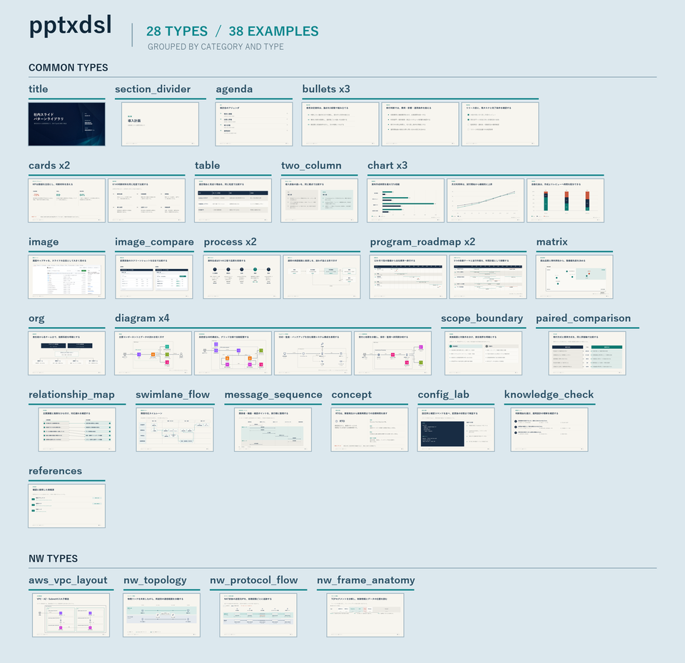

# pptxdsl

「生成 → 検証 → そのまま提出」までを、決定論的に実行するPowerPoint生成パイプライン。


生成AIまたは人間が、スライドの内容と構造を`content.json`へ記述します。
座標・余白・文字サイズ・配線はrendererが決定し、PPTXを毎回同じ結果で生成します。

## 出力例

対応する28種類のtypeを、38枚の出力例で確認できます。



PowerPointで確認・編集できる実物は、[パターンギャラリーの取得・生成手順](examples/gallery/README.md)から入手できます。
Gitには軽量な一覧画像を置き、PPTXはRelease・CI成果物で配布します。
研修資料の構成例は[VLAN基礎研修](examples/training/vlan/README.md)で確認できます。
[AWSネットワーク資料の入力例](examples/training/aws-network/README.md)も収録しています。

理解度チェックの問題・解答、2〜4選択肢、長い選択肢、leadありの専用ギャラリー（8ページ）は、
`python -m tools.gallery.generate_knowledge_cases out/knowledge_gallery.pptx`で生成できます。
同じ内容の問題と正答・解説を隣接ページで比較し、選択肢の列位置と長文の縦並びを確認できます。

## セットアップ

開発時のlint・型検査・coverageは[静的品質ゲート](docs/static-quality.md)を参照してください。

```powershell
git clone https://github.com/thinas1115/pptxdsl.git
cd pptxdsl
python -m pip install -r requirements.txt
```

- Python 3.10以上を前提とします。Windowsでは游ゴシック、非Windowsではfontconfigから
  Noto Sans CJK JPまたはNoto Sans JPを検出します。測定とPPTX指定は同じfamilyへ統一します。
  可変フォント・TTC・明示指定・再現性の条件は[フォント契約](docs/font-contract.md)を参照してください。
- 生成結果を再現できるよう、直接・間接依存のバージョンを`requirements.txt`へ固定しています。
- 素材の再取得を含む開発環境は`python -m pip install -r requirements-dev.txt`で導入します。
  通常生成・Skill・Pluginには不要です。依存区分とOS側の前提は[依存関係](docs/dependencies.md)を参照してください。
- PPTXの生成にPowerPointは不要です。PNG化と目視確認にだけ使用します。
- AWS・Fluentアイコンは`slidegen/assets/icons/`へ同梱済みです。

macOSのフォント準備、生成・機械検査、PowerPointの全ページPNG書出しと実機受入は
[Mac向け手順](docs/macos.md)を参照してください。Windows COM用の`render.ps1`はMacでは使いません。

アイコンの出典とライセンスは[クレジット](slidegen/assets/CREDITS.md)を参照してください。

## 使い方

| 利用形態 | 向いている用途 | 実行に使うもの |
|---|---|---|
| Skill | Skillとして直接導入する、またはこのリポジトリ内で開発する | ReleaseのSkill ZIP、または`.agents/skills/pptxdsl/`とcloneしたPPTX生成コード |
| Plugin | Plugins Directoryから導入する、他の利用者へPluginとして配布する | ReleaseのPlugin ZIPに同梱されたmanifest・Skill・PPTX生成コード・素材 |

Claude Codeでも同じSkill ZIPとPlugin ZIPを使えます。導入先やMarketplaceの登録は
[Claude Code向けの手順](docs/plugin.md#claude-codeでの導入)を参照してください。

どちらも、資料要件と情報源の確認、`content.json`の設計、PPTX生成、機械検証、PNG化、
全ページの目視QA、修正後の再確認までを1つの作業として実行します。

### Skillとして使う

最新の[GitHub Release](https://github.com/thinas1115/pptxdsl/releases/latest)にあるSkill ZIPは自己完結型です。
ZIPを展開し、できた`pptxdsl/`を
CodexのSkillディレクトリへ配置します。`SKILL.md`、renderer、schema、素材が同梱されているため、
リポジトリのcloneは不要です。

このリポジトリ内で開発しながら使う場合は、[セットアップ](#セットアップ)を完了してリポジトリのルートを開きます。
Codexは作業ディレクトリからリポジトリルートまでの`.agents/skills/`を探索するため、
リポジトリ内のSkillを別の場所へコピーする必要はありません。

どちらの導入方法でも、新しいタスクで`$pptxdsl`を明示して依頼します。

```text
$pptxdsl
次の要件と情報源から、目視確認済みのPPTXを作成してください。

- テーマ: AWS AppSyncの設計と運用
- 想定読者: 導入を検討するアプリケーション開発者
- 目的: 採用判断に必要な構成、制約、費用を説明する
- 必須内容: Pipeline resolver、Merged API、認証、監視、料金
- 情報源: ここにURLまたは入力ファイルを書く
- 枚数目安: 30〜40枚
```

Skillは[pptxdsl Skill](.agents/skills/pptxdsl/SKILL.md)を入口に、必要なスキーマ、type選定、
renderer、検証手順を読み込みます。通常は利用者が生成コマンドを個別に指示する必要はありません。
CodexでSkillが候補に出ない場合は、`/skills`で一覧を確認するか、`$`に続けて`pptxdsl`を検索します。

### Pluginとして使う

Plugin版はSkill・PPTX生成コード・素材を同梱するため、利用時にこのリポジトリをcloneする必要がありません。
Python 3.10以上、日本語フォント、PowerPointまたはLibreOfficeなどのレンダリング手段は実行環境側に必要です。

#### 1. 配布物を作る

正式配布は最新の[GitHub Release](https://github.com/thinas1115/pptxdsl/releases/latest)にあるPlugin ZIPです。
開発中の配布候補を作る場合は、未使用の出力先を指定してビルドします。

```powershell
python -m tools.plugin.build --output-dir out\plugins
```

インストール対象は`out/plugins/pptxdsl/`です。生成されたZIPを渡す場合は、
展開後に`plugin.json`が直下にあるフォルダをPluginルートとして使います。

#### 2. Codexへ登録・インストールする

Codexの新しいタスクで、ビルド済みPluginフォルダを指定して依頼します。

```text
$plugin-creator
このビルド済みpptxdsl Pluginを個人marketplaceへ登録してください。
Pluginフォルダ: out/plugins/pptxdsl
```

登録後、Plugins Directoryの個人marketplaceから`pptxdsl`をインストールします。
CLIを使う場合は、実際のmarketplace名を指定します。標準の個人marketplace名は`personal`です。

```text
codex plugin add pptxdsl@personal
```

標準の個人marketplaceは暗黙に検出されるため、`codex plugin marketplace add`は不要です。
インストール後は新しいタスクを開始し、Pluginに含まれるSkillを明示して依頼します。

```text
$pptxdsl
添付資料と以下の要件から、目視確認済みのPPTXを作成してください。
```

ChatGPTでは`@pptxdsl`、Codexでは`$pptxdsl`で明示選択できます。目的に合う依頼であれば、
名前を付けずに依頼して自動選択させることもできます。登録、更新、ChatGPT Workでの導入、
隔離実行の確認方法は[Pluginガイド](docs/plugin.md)を参照してください。

OpenAI公式の基本仕様は[Skills](https://developers.openai.com/docs/build-skills)と
[Pluginパッケージ](https://developers.openai.com/plugins/build/plugins)を参照してください。

## CLIで直接使う

目次・発表順は`agenda`を使います。生成画像による概念説明は
[画像生成から取込・QAまでの手順](.agents/skills/pptxdsl/references/generated-images.md)を参照してください。
手元の画像は`--asset-dir assets`で利用でき、Plugin本体の書き換えは不要です。
背景とフッターを合わせる設定は[テンプレート設定](docs/cover-footer-customization.md)から1コマンドで雛形を作れます。

AIエージェントを使わず、自分で`content.json`を作成して生成・検証する場合の手順です。

### 1. content.jsonを作る

生成AIに作らせる場合:

1. [AI_DECK_PROMPT.md](AI_DECK_PROMPT.md)の入力欄へ、テーマ・想定読者・目的・必須内容・情報源・枚数目安を記入する。
2. 記入した依頼文、[CONTENT_SCHEMA.md](CONTENT_SCHEMA.md)、[type選定ガイド](docs/type-selection-guide.md)を生成AIへ渡す。
3. 返されたJSONを、プロジェクト直下の`content.json`として保存する。

手動で作る場合は、[CONTENT_SCHEMA.md](CONTENT_SCHEMA.md)に沿って`content.json`を記述します。

入力時は次の4点だけ先に確認してください。

- `content.json`は資料ごとに新規作成し、過去資料や回帰ギャラリーの文言を残さない。
- 不明な任意項目は、仮文言や空文字を入れずフィールド自体を省略する。
- 資料の情報構造に合うtypeだけを使い、対応typeがなければ生成AIから利用者へ確認する。
- 座標・余白・文字サイズなどのレイアウト値は記述しない。

typeごとのフィールド、件数、構成図、画像、`lead`の指定方法は
[CONTENT_SCHEMA.md](CONTENT_SCHEMA.md)に集約しています。

### 2. 生成・検証する

```powershell
python slidegen/generate_from_json.py content.json out\deck.pptx
python slidegen/check_layout.py out\deck.pptx
python .agents/skills/pptxdsl/scripts/render_preview.py --probe
python .agents/skills/pptxdsl/scripts/render_preview.py out\deck.pptx out\png
python contact_sheet.py out\png
```

`generate_from_json.py`は生成前にschemaを検証し、不正な入力ではPPTXを生成しません。
Pythonから組み込む場合は、状態がデッキ間で混ざらない[Python生成API](docs/generation-api.md)を使用します。
エラーが出た場合は、表示された`slides[番号] (type=種別)`の内容を修正して再実行します。

`out\png\sheet.png`の一覧と各ページの原寸画像を確認してください。レンダリング補助スクリプトは、
WindowsではPowerPointを優先し、それ以外ではLibreOfficeとPDF画像化手段の組み合わせを探索します。
`--probe`は一時領域で1枚のPPTXを実際にPNGへ変換し、backendの利用可否と失敗時の対処法を返します。
実行ファイルがあるだけでは利用可能と判定しません。LibreOfficeはImpressモジュールも必要です。
最小変換を使う環境判定では各コマンドに60秒の制限を設けますが、通常の資料の変換にはこの制限を適用しません。
機械検証だけでは、文字の読みやすさ、内容の正確性、余白や配線の印象までは判断できません。

Pull Requestと`main`へのpushでは、Windows CIがPython 3.10・3.13の全テスト、主要デッキ生成、
`check_layout.py`を実行します。PowerPointによるPNG化と目視確認はCIで代替せず、提出前に実施します。
固定書体の主要5デッキはWindows・Ubuntu・macOSで生成し、各OSで相互検査します。
macOS CIの構造検査と、PowerPoint for Macでの実機受入は別の工程です。

## 目的別ガイド

| やりたいこと | 参照先 |
|---|---|
| `content.json`のフィールドと制約を確認する | [CONTENT_SCHEMA.md](CONTENT_SCHEMA.md) |
| 内容に合うtypeを選ぶ | [docs/type-selection-guide.md](docs/type-selection-guide.md) |
| 生成AIへの依頼文を作る | [AI_DECK_PROMPT.md](AI_DECK_PROMPT.md) |
| 対応レイアウトを人間が見て確認する | [サンプルスライドギャラリー](examples/gallery/README.md) |
| 新しいtypeやレイアウタを追加する | [EXTENDING.md](EXTENDING.md) |
| 配色・フォント・表紙デザインを変更する | [DESIGN_CUSTOMIZATION.md](DESIGN_CUSTOMIZATION.md) |
| 表紙・フッターだけを利用者別に変更する | [docs/cover-footer-customization.md](docs/cover-footer-customization.md) |
| rendererと品質ゲートの設計を確認する | [docs/architecture.md](docs/architecture.md) |

## 主なディレクトリ

| パス | 内容 |
|---|---|
| `.agents/skills/pptxdsl/` | AIエージェント向けのPPTX作成Skill |
| `slidegen/` | renderer、レイアウトエンジン、validator、PPTX検査コード |
| `slidegen/data/` | 通常入力へのサンプル混入を防ぐ生成済み辞書 |
| `tests/` | 契約・回帰テスト。全件実行は`python -m tests` |
| `tests/fixtures/gallery/` | 回帰専用の内容データ・構成図仕様 |
| `tools/gallery/` | 回帰ギャラリーの生成・検証・掲載画像作成 |
| `tools/assets/` | 素材の取得・点検。通常生成には不要 |
| `tools/distribution/` | Skill・Plugin・GitHub Releaseアセットの共通ビルド |
| `tools/skill/` | 自己完結型Skill配布用ビルド |
| `tools/plugin/` | 自己完結型Plugin配布用ビルド |
| `plugins/pptxdsl/` | Pluginの表示情報・配布metadataの正本 |
| `slidegen/assets/icons/` | 同梱済みのAWS・Fluentアイコン |
| `slidegen/assets/images/` | 本文で使用する画像 |
| `slidegen/assets/cover/` | 利用者が差し替える表紙背景画像 |
| `out/` | PPTX、PNG、検証結果などの生成物。Git管理外 |

実行時の生成物はすべて`out/`へ保存します。`docs/`には保守対象の説明文書と、
その文書から参照する掲載素材だけを置きます。

ギャラリーPPTXは人間がレイアウトを確認するサンプルです。[Release・CIからの取得とローカル生成](examples/gallery/README.md)に対応します。
新しい資料を作る生成AIには渡さず、内容・文言・ページ順の参考資料にも使用しません。
追跡対象と公開履歴の扱いは[ギャラリー配布方針](docs/gallery-distribution.md)を参照してください。

テストや開発ツールはリポジトリルートからmoduleとして実行します。
単体実行例は`python -m tests.test_check_layout`、ギャラリー生成は
`python -m tools.gallery.generate_patterns out/pattern_gallery.pptx`です。
全件実行は失敗後も最後まで続け、各モジュールの成功・失敗・所要時間と、明示された任意検証の
skip理由を表示します。詳細ログは`out/test-results.json`へ保存します。
保存先は`python -m tests --report out/test-results-next.json`で変更できます。
assertを使用する既存テストの最適化実行は拒否します。新規テストには標準のunittestを使い、
既存テストは対象機能の変更時にモジュール単位でTestCaseへ移行します。
各モジュールの`python -m tests.test_xxx`入口とプロセス分離は維持します。
通常のJSON生成・検証は従来のファイル実行とmodule実行の両方に対応します。

## ライセンス

本リポジトリのオリジナルコードおよび文書は、[MIT License](LICENSE)で提供します。

`slidegen/assets/`以下には、AWS Architecture Icons、Fluent UI System Icons、商標、ロゴなど、
第三者が権利を持つ素材が含まれます。これらの素材には本プロジェクトのMIT Licenseを適用せず、
各素材の利用条件が適用されます。出典と条件は[第三者素材に関する通知](THIRD_PARTY_NOTICES.md)と
[クレジット](slidegen/assets/CREDITS.md)を参照してください。

本ソフトウェアを使用して利用者が作成した`content.json`やPPTXには、本プロジェクトの
MIT Licenseを適用しません。ただし、出力へ含まれる第三者素材には各素材の利用条件が適用されます。
